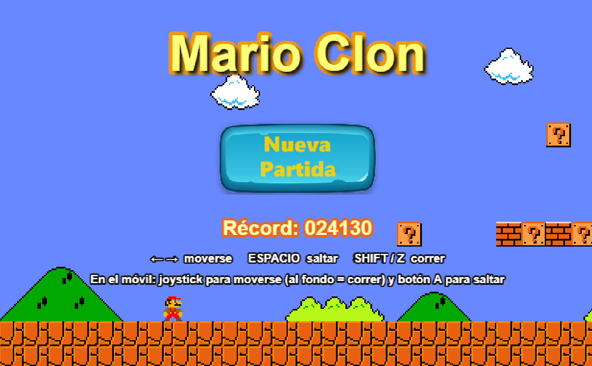
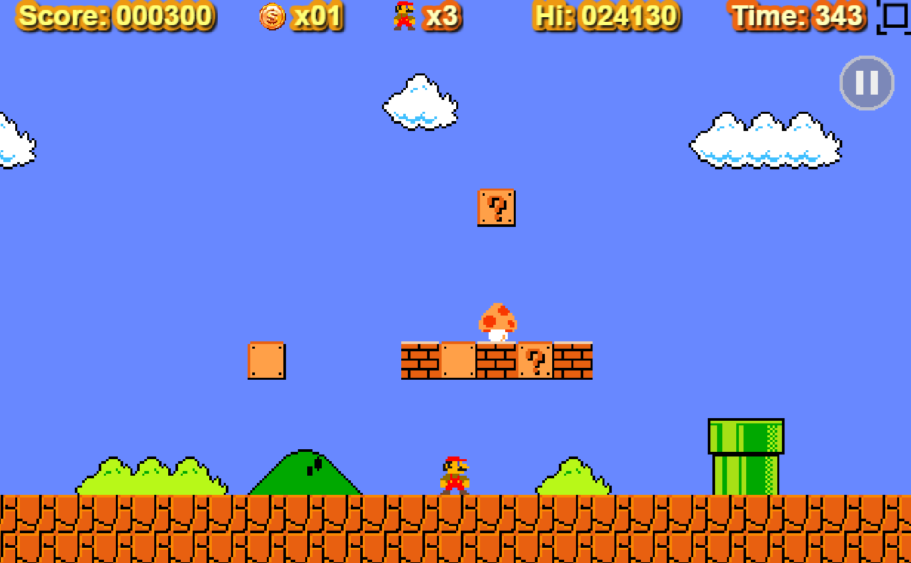
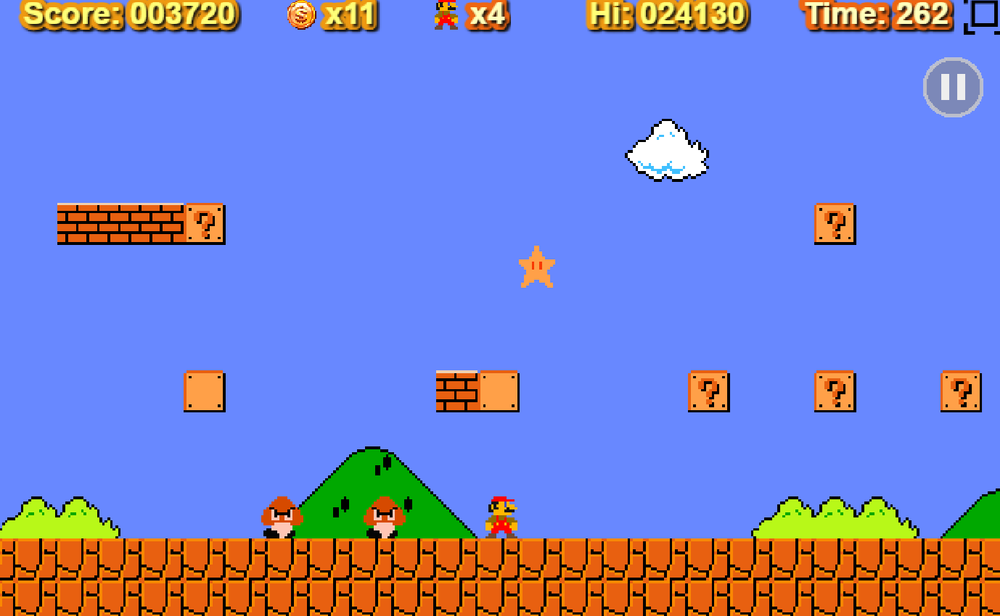
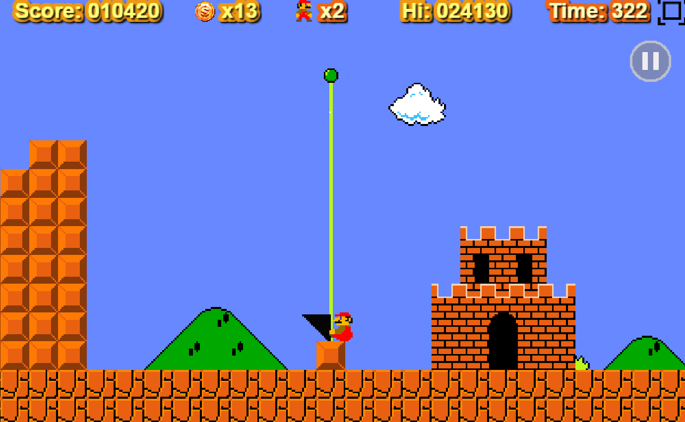

# marioLevel1-1

Proyecto recreando el nivel 1-1 del juego clásico Super Mario Bros, usando
la librería Phaser.

**Jugar:** https://juan1639.github.io/marioLevel1-1

<table>
  <tr>
    <td></td>
    <td></td>
  </tr>
  <tr>
    <td></td>
    <td></td>
  </tr>
</table>

## Controles

| Acción | Teclado | Móvil / táctil |
|---|---|---|
| Moverse | ← → | Joystick (izquierda) |
| Correr | Mantener SHIFT o Z | Joystick empujado hasta el borde |
| Saltar | ESPACIO (más tiempo pulsado = salto más alto) | Botón **A** (derecha) |
| Pausa | P o ESC | Botón de pausa (arriba a la derecha) |
| Empezar partida | ESPACIO o ENTER | Tocar "Nueva Partida" |

Si la partida se empieza tocando la pantalla, los controles táctiles se activan solos. Durante el juego también se pueden activar tocando "Touch controls" (abajo a la izquierda).

El juego se pausa automáticamente al cambiar de pestaña o de ventana.

## Qué incluye

- Mario pequeño y grande, con salto variable y botón de correr.
- Bloques "?" con monedas, setas, seta de vida extra y estrella; ladrillos que se rompen (siendo grande) y un ladrillo de varias monedas.
- Goombas: se aplastan saltando encima, golpeando desde abajo el bloque en el que están o con la estrella.
- Vidas, contador de monedas (100 monedas = 1 vida), tiempo (400) y puntuación.
- Punto de reaparición a mitad de nivel; los bloques ya usados siguen así al perder una vida.
- Fin de nivel con bandera: puntos según la altura y el tiempo sobrante.
- Récord guardado en el navegador, con nombre.
- Menú principal, pausa y pantalla de Game Over.

## Desarrollo

Requisitos: [Node.js](https://nodejs.org) (18 o superior).

| Comando | Descripción |
|---|---|
| `npm install` | Instala las dependencias |
| `npm run dev` | Servidor de desarrollo con recarga automática en http://localhost:8080 |
| `npm run dev -- --host` | Igual, pero accesible desde otros dispositivos de la red (para probar en el móvil) |
| `npm run build` | Genera la versión de producción en la carpeta `dist` |

Casi todos los valores ajustables del juego (velocidades, puntos, tiempos, posiciones de goombas, punto de reaparición...) están en `src/scenes/settings.js`.

## Publicación

El juego se publica en GitHub Pages automáticamente con GitHub Actions (`.github/workflows/deploy.yml`): cada push a la rama `main` compila el proyecto y publica la carpeta `dist`.

En el repositorio, **Settings → Pages → Source** debe estar en **GitHub Actions**.

## Estructura

```
src/
  main.js          Configuración de Phaser y lista de escenas
  scenes/          Escenas: Boot, Preloader, MainMenu, Game, Pausa, GameOver
                   y settings.js (configuración y estado del juego)
  components/      Objetos del juego: Mario, goombas, setas, monedas, marcadores, fin de nivel...
  utils/           Colisiones y funciones comunes
public/assets/     Mapa de Tiled, imágenes y sonidos
docs/              Capturas de pantalla del README (no se publican con el juego)
```

## Tecnologías

- [Phaser 3](https://phaser.io) (físicas arcade)
- [Vite](https://vitejs.dev)
- [phaser3-rex-plugins](https://github.com/rexrainbow/phaser3-rex-notes) (joystick virtual)
- Mapa del nivel creado con [Tiled](https://www.mapeditor.org)

Basado en la plantilla oficial [Phaser + Vite](https://github.com/phaserjs/template-vite) (licencia MIT, ver `LICENSE`).
